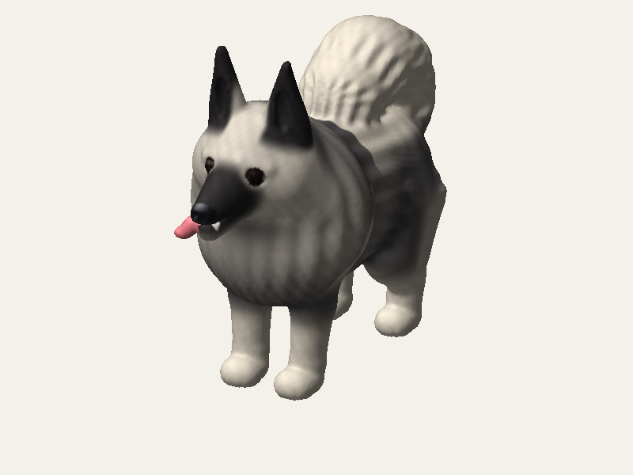

# Fluffy Keeshond Dog (`dog.jpg`) — 3D Print Model

An anatomically proportioned **Keeshond** (*Wolfspitz* / Dutch Barge Dog) figurine modeled from `dog.jpg` and the AKC Keeshond breed standard, designed for **Bambu Lab A1 Mini**, **Bambu Studio**, and **MakerWorld**.



## Overview

This model captures the signature Keeshond spitz silhouette, coat structure, and facial expression from `dog.jpg`:
- **Square-Proportioned Spitz Profile:** Compact, sturdy body where the height at the withers matches the length from shoulder to buttocks, with a deep chest, level slightly-sloping topline, and subtle waist tuck-up.
- **Lion-Like Neck Ruff & Trousers:** Profuse, stand-off neck ruff (`mane`) around the neck, shoulders, and brisket with subtle flowing groom locks, paired with feathered hind "trousers" above the hocks.
- **Chiseled Fox-Like Wedge Head & "Spectacles":** Cleanly sculpted wedge skull with a defined stop, medium tapered muzzle, obliquely set almond eyes with orbital "spectacles" brow arches, and high-set, sharply pointed triangular erect ears.
- **Happy Open Mouth & Sideways Lolling Tongue:** Slightly open smiling mouth showing the lower teeth arch and a cute tongue lolling out to the right side of the muzzle just like `dog.jpg`.
- **Tightly Curled Plumed Tail:** High-set spitz tail curled forward flat over the back so it prints cleanly without floating tail islands.
- **4 Trim Lower Legs & Cat-Like Paws:** Fine-boned lower legs below the wrists and hocks ending in compact, 4-toed cat-like paws resting flat on the `Z = 0` build plate.
- **100% Watertight 2-Manifold Mesh:** Verified with `0` non-manifold edges and `0` unmatched half-edges.

---

## Included Files

| File | Description |
| :--- | :--- |
| [`keeshond_dog.3mf`](keeshond_dog.3mf) | Ready-to-slice **3MF** project file pre-configured for **Bambu Lab A1 mini** (`0.4 mm` nozzle, `Textured PEI Plate`, `PLA`, breakaway supports + `5 mm` brim). |
| [`keeshond_dog.gcode.3mf`](keeshond_dog.gcode.3mf) | Pre-sliced **G-code 3MF** ready for direct wireless FTPS printing on the Bambu Lab A1 Mini. |
| [`keeshond_dog.stl`](keeshond_dog.stl) | Watertight, 2-manifold binary **STL** mesh. |
| [`keeshond_dog.scad`](keeshond_dog.scad) | Parametric **OpenSCAD** source file. |
| [`generate_keeshond_dog.py`](generate_keeshond_dog.py) | Standalone Python parametric SDF generator, manifold verifier, and SVG/PNG renderer. |
| [`keeshond_dog_preview.png`](keeshond_dog_preview.png) | Shaded 3/4 front raster preview image with continuous Keeshond coat markings. |
| [`keeshond_dog_preview.svg`](keeshond_dog_preview.svg) | Shaded 3/4 front vector preview image. |

---

## Key Dimensions (`scale_factor = 1.0`)

| Parameter | Default Value | Description |
| :--- | :--- | :--- |
| `withers_height` | `29.5 mm` | Height at shoulders/withers |
| `body_length` | `28.5 mm` | Point of shoulder to buttocks (square spitz profile) |
| `ruff_radius` | `10.6 mm` | Radius of the lion-like neck ruff & chest mane |
| `skull_width` / `muzzle_length` | `12.6 / 7.4 mm` | Fox-like wedge head and tapered snout |
| `ear_height` | `7.6 mm` | High-set erect pointed triangular spitz ears |
| `tail_plume_radius` | `4.6 mm` | Tightly curled plumed tail lying over the back |

---

## Customizing & Direct Wireless Printing (`deploy_to_printer.py`)

To customize the size or proportions, edit `PARAMS` at the top of [`generate_keeshond_dog.py`](generate_keeshond_dog.py) and run:

```bash
python3 generate_keeshond_dog.py
```

To rebuild, slice headlessly with **Bambu Studio (`v02.08.02.61`)**, and upload directly to your **Bambu Lab A1 Mini** over Wi-Fi:

```bash
python3 ../scripts/deploy_to_printer.py --model-dir . --ip <PRINTER_IP> --access-code <8_DIGIT_ACCESS_CODE> --filament PLA
```
