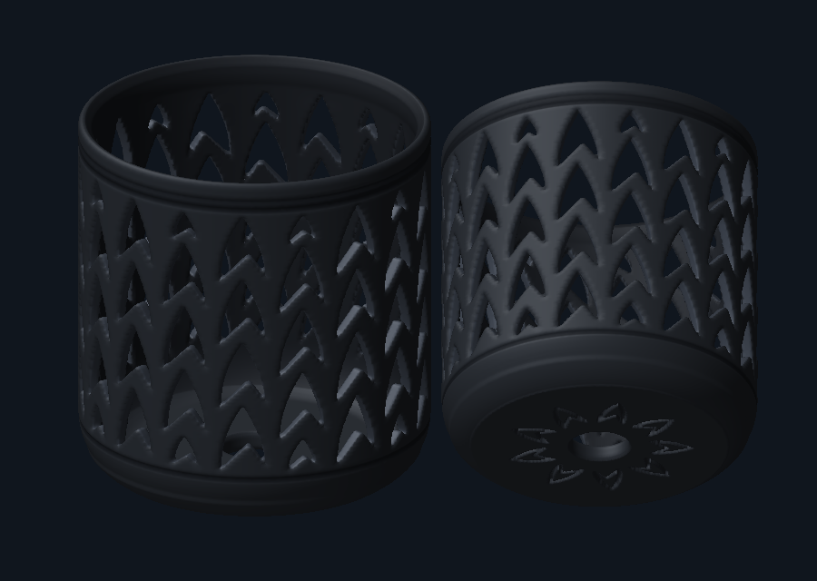

# LARQ Bottle PureVis 2 (23 oz / 680 ml) — Star Trek Delta Mesh TPU Boot

A custom, 3D-printable flexible **TPU protective bottle boot** with an interlocking **Star Trek Starfleet Delta shield lattice mesh**, designed specifically for the **23 oz (680 ml) LARQ Bottle PureVis 2** (`74.5 mm` base diameter) and optimized for support-free printing on the **Bambu Lab A1 mini**.



## Overview & Design Features

- **Tailored Fit for LARQ Bottle PureVis 2 (23 oz / 680 ml):**
  - Engineered with a `74.6 mm` nominal inner diameter (`R_in = 37.3 mm`), `18` subtle internal vertical micro-grip ribs (`0.22 mm` depth), and an upper `0.30 mm` inward TPU retention bead below a `45°` entry chamfer—providing a snug, slip-free elastic grip that slides on smoothly and stays locked in place.
- **Interlocking Starfleet Delta Shield Lattice Mesh (`54` Sleeve Cutouts + `9` Base Vents):**
  - Features `18` staggered columns around the `85.0 mm` tall sleeve (`9` even columns with `4` full-size Star Trek Deltas + `9` odd columns with `3` full-size Deltas and `2` compact border Deltas).
  - Every cutout is an **upright Star Trek Starfleet Delta shield** with swept convex arrowhead flanks, a pointed top apex, a concave boomerang bottom arch, and `45°` chamfered inner/outer edges.
- **100% Support-Free TPU Print Geometry:**
  - Because every Star Trek Delta roof converges to a steep pointed arrowhead peak (`~24°` half-angle from vertical = `66°` from build plate) and every bottom arch sweeps upward at a self-supporting angle, the entire mesh prints cleanly in flexible **TPU 95A / 90A** with **zero supports** and **zero horizontal bridges**.
- **Shock-Absorbing Rounded Heel & Air-Escape Vent (Matched to Official LARQ Silicone Boot):**
  - Contoured with a `10.5 mm` internal toroidal heel radius (`Z = 4.5 – 15.0 mm`) that hugs the rounded bottom of the LARQ Bottle PureVis 2 with zero air gap, paired with a `13.5 mm` rounded outer heel curve (`Z = 0.0 – 13.5 mm`) matching the sleek bowl-like profile of the official LARQ Silicone Boot while remaining 100% self-supporting on the print bed.
  - `4.5 mm` cushioned bottom floor with a `15.0 mm` central air-escape hole (prevents trapped air from acting as a piston when inserting the bottle), `9` radial recessed Starfleet Delta vents on the flat standing pad, and recessed **Starfleet Command double-pinstripe collar grooves**.

---

## Included Files

| File | Description |
| :--- | :--- |
| [`larq2_star_trek_boot.3mf`](larq2_star_trek_boot.3mf) | Ready-to-slice **3MF** project file pre-configured for **Bambu Lab A1 mini (`Bambu TPU 95A @BBL A1M`)**. |
| [`larq2_star_trek_boot.stl`](larq2_star_trek_boot.stl) | Watertight, 2-manifold binary **STL** mesh. |
| [`larq2_star_trek_boot.scad`](larq2_star_trek_boot.scad) | Parametric **OpenSCAD** source file. |
| [`generate_larq2_boot.py`](generate_larq2_boot.py) | Standalone Python parametric generator (zero external dependencies) that builds the `.stl`, `.3mf`, `.scad`, and preview images. |
| [`larq2_star_trek_boot_preview.png`](larq2_star_trek_boot_preview.png) | Dual-angle rendered 3D preview image (top-front isometric + underside base view). |
| [`larq2_star_trek_boot_preview.svg`](larq2_star_trek_boot_preview.svg) | Vector 3D isometric preview image. |

---

## Default Parametric Dimensions

| Parameter | Value | Description |
| :--- | :--- | :--- |
| `bottle_od` | `74.5 mm` | Official LARQ Bottle PureVis 2 (`23 oz / 680 ml`) base diameter (`2.93 in`) |
| `inner_diameter` | `74.6 mm` | Nominal boot bore diameter (with `0.22 mm` internal grip ribs) |
| `wall_thickness` | `3.2 mm` | Radial wall thickness (`81.0 mm` outer diameter; `4` perimeter walls with `0.4 mm` nozzle) |
| `total_height` | `85.0 mm` | Total height of the tall protective grip sleeve |
| `base_thickness` | `4.5 mm` | Thickness of the cushioned bottom impact floor |
| `lower_bumper_height` | `15.0 mm` | Contoured lower impact bumper height before mesh cutouts begin |
| `outer_heel_radius` | `13.5 mm` | Rounded outer bottom heel radius (official LARQ boot profile) |
| `inner_heel_radius` | `10.5 mm` | Contoured inner bottom radius matching the LARQ 2 rounded base |
| `upper_collar_height` | `9.0 mm` | Solid upper retention collar height with Starfleet Command trim grooves |
| `center_vent_diameter` | `15.0 mm` | Central bottom air-release hole diameter |
| `num_columns` | `18` | Number of staggered circumferential Starfleet Delta columns |
| `delta_width` | `10.2 mm` | Width of each full Star Trek Delta cutout across the lower wingtips |
| `delta_height` | `16.2 mm` | Height of each full Star Trek Delta cutout (`~1.6x` width matched to `Delta-shield.png`) |
| `delta_arch_rise` | `0.38` | Asymmetric concave bottom arch peak fraction (`x = 0.64`) matched to `Delta-shield.png` |

---

## Recommended TPU Print Settings (Bambu Lab A1 mini)

- **Filament Preset:** `Bambu TPU 95A @BBL A1M` (feed from external spool holder — do **not** feed soft TPU through AMS Lite)
- **Nozzle Temperature:** `215 °C` (`220 °C` initial layer) & `3.2 mm³/s` max volumetric speed to prevent TPU heat-creep oozing
- **Retraction & Wipe:** `1.2 mm` retraction length (`35 mm/s` retract, `25 mm/s` deretract), `70%` retract before wipe, `2.0 mm` wipe distance, **Z-hop disabled (`0 mm`)**
- **Travel & Wall Routing:** `Avoid crossing wall` enabled (`100%` detour), `Arachne` variable-width wall generator (eliminates tiny gap-fill squirts), `Nearest` seam placement
- **Build Plate:** `Textured PEI Plate`
- **Print Orientation:** Upright, flat on the base (`Z = 0`)
- **Layer Height:** `0.20 mm`
- **Wall Loops:** `4` walls
- **Infill:** `25%` Gyroid (for cushioned shock absorption in the `4.5 mm` bottom base pad)
- **Supports:** **Disabled (`None`)** — all Star Trek Delta cutouts are self-supporting

---

## Customizing & Wireless Slicing / Printing

To customize the fit (for example, to adapt to the `34 oz / 1 L` LARQ 2 bottle at `83.0 mm` diameter), edit `PARAMS` at the top of [`generate_larq2_boot.py`](generate_larq2_boot.py) and run:

```bash
python3 generate_larq2_boot.py
```

To slice headlessly with the official **Bambu Studio CLI** (`Bambu TPU 95A @BBL A1M`) and optionally deploy directly to your A1 mini over Wi-Fi FTPS:

```bash
python3 ../scripts/deploy_to_printer.py --model-dir . --filament TPU --slice-only
```
