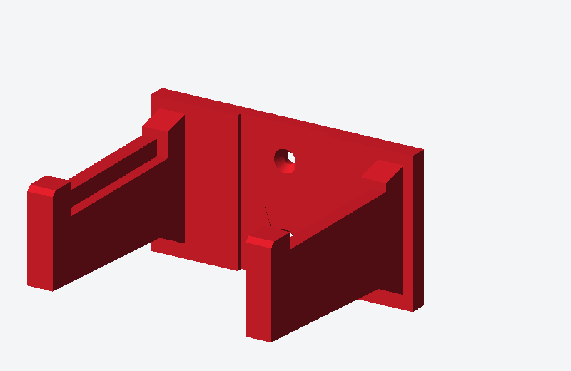

# Craftsman V20 Handheld Vacuum Wall Mount (`CMCVH001B`)

A custom, 3D-printable wall mount and cradle designed for the **CRAFTSMAN V20 Cordless Handheld Vacuum** (Model `CMCVH001B` / Lowe's Item `#5000250841`).



## Overview

This wall hanger cradles the upper neck of the Craftsman V20 handheld vacuum right below the battery shoe, allowing the vacuum to hang vertically nose-down **with the V20 battery still attached** for quick grab-and-go use.

### Key Features
- **Two-Arm Cradle with Recessed Inner Ledges:** Each arm includes a `4.5 mm × 7.0 mm` stepped inner pocket (`67 mm` long) that locks onto the side housing rails of the vacuum.
- **Front Retention Hooks:** Upturned `13.0 mm` lips at the front tips prevent the vacuum from sliding forward off the mount.
- **Reinforced Backplate & Gussets:** `114 mm × 62 mm × 8 mm` wall plate with upper and lower base gussets at the arm roots.
- **Countersunk Mounting Holes:** Recessed center channel with two countersunk screw holes (`4.8 mm` shaft diameter, `9.6 mm` countersink diameter, `32 mm` vertical spacing) sized for `#8` or `#10` wood/drywall screws.
- **Support-Free Printing:** Pre-oriented flat on the backplate (`Z = 0`) so it prints cleanly without supports.

---

## Included Files

| File | Description |
| :--- | :--- |
| [`craftsman_v20_vacuum_mount.3mf`](craftsman_v20_vacuum_mount.3mf) | Ready-to-slice **3MF** project file pre-oriented for Bambu Studio, MakerWorld, and Bambu Handy. |
| [`craftsman_v20_vacuum_mount.stl`](craftsman_v20_vacuum_mount.stl) | Watertight, 2-manifold binary **STL** mesh (`1,360` triangles). |
| [`craftsman_v20_vacuum_mount.scad`](craftsman_v20_vacuum_mount.scad) | Parametric **OpenSCAD** source file. |
| [`generate_vacuum_mount.py`](generate_vacuum_mount.py) | Standalone Python parametric generator (zero external dependencies) that builds the `.stl`, `.3mf`, `.scad`, and preview images. |
| [`deploy_to_printer.py`](deploy_to_printer.py) | Automated build, headless Bambu Studio slicer (`v02.08.02.61`), and wireless FTPS uploader (`port 990`) to send pre-sliced `.gcode.3mf` files directly to a Bambu Lab A1 Mini. |
| [`craftsman_v20_vacuum_mount_preview.png`](craftsman_v20_vacuum_mount_preview.png) | Rendered 3D isometric preview image. |
| [`craftsman_v20_vacuum_mount_preview.svg`](craftsman_v20_vacuum_mount_preview.svg) | Vector 3D isometric preview image. |
| [`KB.md`](KB.md) | Knowledge base covering Bambu Lab A1 mini presets, MakerWorld `.3mf` requirements, and headless Bambu Studio CLI workflows. |

---

## Default Dimensions

| Parameter | Value | Description |
| :--- | :--- | :--- |
| `inner_gap_width` | `84.0 mm` | Inside clearance between the left and right arms |
| `arm_thickness` | `11.0 mm` | Width/thickness of each cradle arm |
| `arm_reach` | `92.0 mm` | Extension length of the arms from the backplate face |
| `backplate_width` | `114.0 mm` | Total width of the wall plate |
| `backplate_height` | `62.0 mm` | Total height of the wall plate |
| `backplate_thickness` | `8.0 mm` | Thickness of the wall plate |
| `ledge_width` | `4.5 mm` | Inset width of the inner cradle step |
| `ledge_drop` | `7.0 mm` | Depth of the inner cradle pocket below the outer arm wall |
| `hook_length` | `13.0 mm` | Front-to-back length of the upturned retention tip |
| `hole_spacing_y` | `32.0 mm` | Center-to-center vertical distance between mounting screws |

---

## Recommended 3D Print Settings (Bambu Studio / Bambu Handy)

- **Material:** PETG, ABS/ASA, or PLA+ / Tough PLA
- **Print Orientation:** Flat on the backplate (`Z = 0` on the build plate, arms pointing straight up)
- **Supports:** **None** (all overhangs are self-supporting)
- **Layer Height:** `0.20 mm` Standard
- **Wall Loops / Perimeters:** `4` to `5` walls (for maximum strength at the arm base)
- **Infill:** `25% – 35%` Gyroid or Grid

---

## Customizing Dimensions & Direct Wireless Printing (`deploy_to_printer.py`)

To adjust tolerances or dimensions, edit the `PARAMS` dictionary at the top of [`generate_vacuum_mount.py`](generate_vacuum_mount.py) and run:

```bash
python3 generate_vacuum_mount.py
```

This automatically verifies that the mesh is watertight/2-manifold and regenerates the `.stl`, `.3mf`, `.scad`, `.svg`, and `.png` files.

### Direct Wireless Build, Slice & Upload to Bambu Lab A1 Mini

You can also rebuild the 3D geometry, slice it headlessly with the official **Bambu Studio (`v02.08.02.61`)** CLI for the **Bambu Lab A1 mini** (`0.20mm Strength @BBL A1M`, `4` walls, `25%` Gyroid infill, `Textured PEI Plate`), and upload the pre-sliced `craftsman_v20_vacuum_mount.gcode.3mf` directly to your printer over Wi-Fi (FTPS port `990`) in a single command:

```bash
python3 deploy_to_printer.py --ip <PRINTER_IP> --access-code <8_DIGIT_ACCESS_CODE> --filament PLA
```

- Use `--filament PLA` (defaults to `Bambu PLA Matte @BBL A1M` Gray) or `--filament PETG` (`Bambu PETG Basic @BBL A1M 0.4 nozzle`).
- Use `--slice-only` to generate the sliced `.gcode.3mf` and updated `.3mf` locally without uploading.
- Once uploaded, tap **Print Files** on the A1 Mini touchscreen and select `craftsman_v20_vacuum_mount.gcode.3mf` to start printing immediately.
