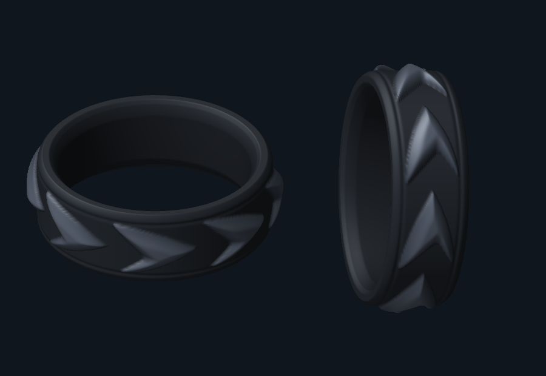

# Star Trek Delta Raised-Relief TPU Ring (US Size 6.5 — 7.0 mm Width)

A custom, 3D-printable flexible **TPU comfort-fit ring** (`US Ring Size 6.5`, `17.05 mm` calibrated inner diameter for `16.92 mm` standard Size 6.5 finger fit, `7.0 mm` band width) featuring **8 raised, rounded Star Trek Starfleet Delta shields** (matched to `Delta-shield.png`) repeating nose-to-tail along the circumference of the band, optimized for support-free printing on the **Bambu Lab A1 mini**.



## Overview & Design Features

- **Tailored for US Ring Size 6.5 (`17.05 mm` Calibrated ID) & `7.0 mm` Band Width with Comfort-Fit Bevelled Inside Edges:**
  - Engineered with a `17.05 mm` nominal inner diameter (`16.92 mm` standard US Size 6.5 + `0.13 mm` FDM inner-bore compensation), generous `1.25 mm × 0.75 mm` rounded comfort-fit inside bevels at both top and bottom rims (`Z = 0` and `Z = 7.0 mm`), plus a continuous `0.15 mm` convex comfort-fit interior curve so the ring slides smoothly over the knuckle with zero sharp edges.
  - `2.00 mm` base band radial thickness (`21.05 mm` base outer diameter) framed by `0.85 mm` rounded outer rim edges and subtle recessed border grooves.
- **Raised & Rounded Starfleet Delta Pattern Repeating Long-Wise (`8` Nose-to-Tail Deltas):**
  - Features `8` asymmetrical **Star Trek Starfleet Delta shields** (`7.80 mm` length × `4.90 mm` wing span, `~1.6:1` aspect ratio matched to `Delta-shield.png`) oriented horizontally (nose-to-tail) in a continuous loop around the circumference.
  - Each Delta rises `+0.90 mm` above the base band (`21.47 mm` peak outer diameter) with a smooth, pillowed elliptical-dome 3D cross-section.
  - Mapped with right-handed tangent chirality (`e_u × e_v = +e_r`) so that when any Delta points upward, the longer sweeping wingtip is on the **left** and the concave tail arch peaks to the **right of center**, matching `Delta-shield.png`.
- **100% Support-Free TPU Print Geometry:**
  - All raised dome flanks transition smoothly from the band cylinder without sharp horizontal overhangs, printing cleanly upright (`Z = 0` flat on the build plate) with **zero supports**.

---

## Included Files

| File | Description |
| :--- | :--- |
| [`star_trek_delta_ring.3mf`](star_trek_delta_ring.3mf) | Ready-to-slice **3MF** project file pre-configured for **Bambu Lab A1 mini (`Bambu TPU 95A @BBL A1M`)**. |
| [`star_trek_delta_ring.stl`](star_trek_delta_ring.stl) | Watertight, 2-manifold binary **STL** mesh (`115,200` triangles, `0` non-manifold edges). |
| [`star_trek_delta_ring.scad`](star_trek_delta_ring.scad) | Parametric **OpenSCAD** source file. |
| [`generate_star_trek_ring.py`](generate_star_trek_ring.py) | Standalone Python parametric generator (zero external dependencies) that builds the `.stl`, `.3mf`, `.scad`, and preview images. |
| [`star_trek_delta_ring_preview.png`](star_trek_delta_ring_preview.png) | Dual-angle rendered 3D preview image (3/4 isometric + upright Delta display view). |
| [`star_trek_delta_ring_preview.svg`](star_trek_delta_ring_preview.svg) | Vector 3D isometric preview image. |

---

## Default Parametric Dimensions

| Parameter | Value | Description |
| :--- | :--- | :--- |
| `us_ring_size` | `6.0` | Standard US Ring Size 6 |
| `inner_diameter` | `16.51 mm` | Nominal finger bore diameter (`R_in = 8.255 mm`) |
| `band_width` | `7.0 mm` | Total band width / print height along `Z` |
| `base_wall_thickness` | `1.85 mm` | Base band radial wall thickness before raised Delta relief (`20.21 mm` base OD) |
| `inner_comfort_bevel` | `0.60 mm` | Rounded comfort-fit inner rim bevel at top and bottom edges |
| `outer_rim_bevel` | `0.65 mm` | Smooth outer rim rounding at top and bottom edges |
| `num_deltas` | `8` | Number of nose-to-tail Starfleet Deltas around the circumference |
| `delta_length` | `7.80 mm` | Length of each Star Trek Delta along the circumference |
| `delta_wing_span` | `4.90 mm` | Width of each Star Trek Delta across the `7.0 mm` band |
| `delta_relief_height` | `0.90 mm` | Raised 3D pillowed dome height above the base band (`21.47 mm` peak OD) |
| `delta_arch_rise` | `0.38` | Asymmetric concave tail arch peak fraction (`x = 0.64`) matched to `Delta-shield.png` |

---

## Customizing & Wireless Slicing / Printing

To customize the ring size or band width, edit `PARAMS` at the top of [`generate_star_trek_ring.py`](generate_star_trek_ring.py) and run:

```bash
python3 generate_star_trek_ring.py
```

To slice headlessly with the official **Bambu Studio CLI** (`Bambu TPU 95A @BBL A1M` with anti-stringing TPU settings) and deploy to your A1 mini:

```bash
python3 ../scripts/deploy_to_printer.py --model-dir . --filament TPU --slice-only
```
