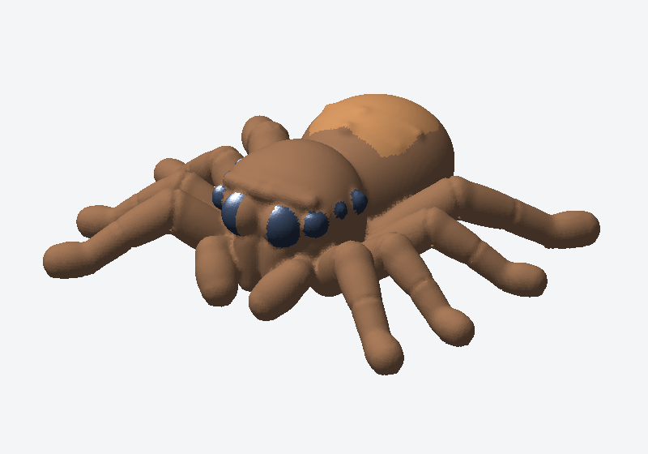

# Tiny Jumping Spider (*Salticidae*) — 3D Print Model

A cute, articulated-look **Tiny Jumping Spider** (*Salticidae* / "Lucas the Spider" inspired) designed for **Bambu Lab A1 Mini**, **Bambu Studio**, and **MakerWorld**.



## Overview

This miniature jumping spider features organic, rounded anatomical segments designed to print cleanly flat on the build plate (`Z = 0`):
- **8 Sculpted Jumping Spider Eyes:** Two large forward-facing Anterior Median Eyes (`3.6 mm` diameter) with raised socket rims, flanked by two Anterior Lateral Eyes and four side/posterior watchful eyes (`PME` & `PLE`) beneath an expressive brow ridge.
- **Fuzzy Pedipalps & Chelicerae:** Rounded front feelers ("mittens") and stout vertical jaws resting naturally on the build plate.
- **8 Round, Segmented Legs (Zero Blocky Curtains):** Each of the 8 legs is modeled with smooth, round anatomical segments (**Coxa → Plump Muscular Femur → Patella Knee Joint Crease → Tapered Tibia → Metatarsus → Rounded Tarsus Paw Pad**) with open arches underneath.
- **Plump Oval Abdomen:** Features 4 subtle dorsal chevron ridges and rear spinneret buds.
- **100% Watertight 2-Manifold Mesh:** Verified `97,204` triangles with `0` non-manifold edges and `0` unmatched half-edges (`2.93 cm³` volume).

---

## Included Files

| File | Description |
| :--- | :--- |
| [`tiny_jumping_spider.3mf`](tiny_jumping_spider.3mf) | Ready-to-slice **3MF** project file pre-configured for **Bambu Lab A1 mini** (`0.4 mm` nozzle, `Textured PEI Plate`, `PLA`). |
| [`tiny_jumping_spider.gcode.3mf`](tiny_jumping_spider.gcode.3mf) | Pre-sliced **G-code 3MF** ready for direct wireless FTPS printing on the Bambu Lab A1 Mini. |
| [`tiny_jumping_spider.stl`](tiny_jumping_spider.stl) | Watertight, 2-manifold binary **STL** mesh (`97,204` triangles). |
| [`tiny_jumping_spider.scad`](tiny_jumping_spider.scad) | Parametric **OpenSCAD** source file. |
| [`generate_jumping_spider.py`](generate_jumping_spider.py) | Standalone Python parametric SDF generator, manifold verifier, and SVG/PNG renderer. |
| [`tiny_jumping_spider_preview.png`](tiny_jumping_spider_preview.png) | Shaded 3/4 front raster preview image. |
| [`tiny_jumping_spider_preview.svg`](tiny_jumping_spider_preview.svg) | Shaded 3/4 front vector preview image. |

---

## Key Dimensions (`scale_factor = 1.0`)

| Parameter | Default Value | Description |
| :--- | :--- | :--- |
| **Overall Footprint** | `35.6 × 31.2 × 11.2 mm` | Total width (`X`) × length (`Y`) × height (`Z`) |
| `head_width` / `head_length` | `11.6 × 10.6 mm` | Boxy-rounded jumping spider cephalothorax |
| `abdomen_width` / `abdomen_length` | `12.2 × 13.6 mm` | Plump oval abdomen with dorsal chevrons |
| `ame_radius` | `1.80 mm` (`3.6 mm` dia) | Giant front-center Anterior Median Eyes |
| `ale_radius` | `1.08 mm` (`2.16 mm` dia) | Front-outer Anterior Lateral Eyes |
| `leg_thickness` | `1.42 mm` base radius | Round segmented legs with knee & tibia joint creases |

---

## Customizing & Direct Wireless Printing (`deploy_to_printer.py`)

To customize the size or proportions, edit `PARAMS` at the top of [`generate_jumping_spider.py`](generate_jumping_spider.py) and run:

```bash
python3 generate_jumping_spider.py
```

To rebuild, slice headlessly with **Bambu Studio (`v02.08.02.61`)**, and upload directly to your **Bambu Lab A1 Mini** over Wi-Fi:

```bash
python3 ../scripts/deploy_to_printer.py --model-dir . --ip <PRINTER_IP> --access-code <8_DIGIT_ACCESS_CODE> --filament PLA
```
