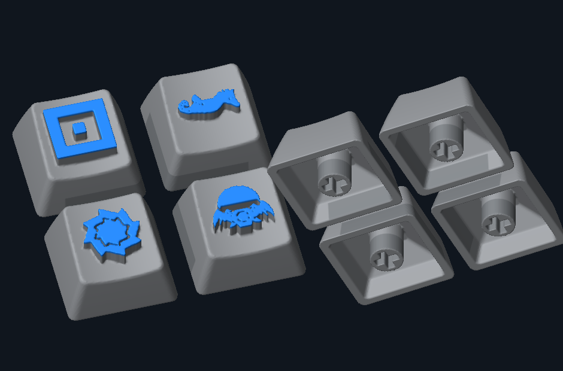

# Wooting 80HE Arrow Keycaps — 2-Tone Geometry Dash 4-Key Set (Official OEM R1 Profile)

A custom 3D-printable 4-keycap arrow cluster replacement set (`Cube`, `Ship`, `Ball`, `UFO`) engineered specifically to match the **official Wooting 80HE OEM R1 profile** (sloped top with a raised back edge and cylindrical concave finger scoop, plus Lekker V2 Hall Effect / Cherry MX cross-stems) and sliced for **2-Tone Bambu PLA Matte** (White keycap + Blue icon) printing on the **Bambu Lab A1 Mini** without an AMS.

---

## Key Features & Official OEM R1 Geometry

1. **Authentic Wooting 80HE OEM R1 Sculpted Profile:**
   - **Sloped Top (Raised on Back Edge):** Matches the stock Wooting 80HE bottom-row/arrow-key OEM R1 profile—sloping from **`8.40 mm` at the lower front lip** up to **`10.00 mm` at the raised back edge** (`~6.5°` ergonomic tilt), with an asymmetric `-0.65 mm` forward dish offset and `12.70 mm × 14.20 mm` top finger area.
   - **Cylindrical Concave Finger Dish:** Features a **`0.72 mm` deep cylindrical concave scoop** across the left-to-right (`X`) axis (plus subtle `0.14 mm` longitudinal cradling) so the left and right edges form raised cradling rims and the center is scooped for the fingertip.
2. **2-Tone Printing Without AMS (Automatic Pause at `Z = 10.20 mm`):**
   - **Color 1 — White PLA Matte (Layers 1–50, `Z = 0.00 – 10.00 mm`):** Prints all 4 sculpted OEM R1 keycap bodies, the sloped/concave finger dishes, the raised `10.00 mm` back rims, and the lower pedestals of the icons emerging from the concave dish in **White PLA Matte**.
   - **Automatic Pause (`M400 U1` at Layer 51, `Z = 10.20 mm`):** Right after the highest white keycap rim (`10.00 mm`) completes, the sliced [`wooting_80he_keycaps.gcode.3mf`](wooting_80he_keycaps.gcode.3mf) automatically pauses the A1 Mini and parks the nozzle.
   - **Color 2 — Blue PLA Matte (Layers 51–53, `Z = 10.20 – 10.60 mm`):** After swapping from White PLA Matte to Blue PLA Matte on the external spool holder and tapping **Resume**, the printer prints the top 3 layers of all 4 Geometry Dash icons in **Blue PLA Matte** without staining any part of the white keycap rim.
3. **4 Geometry Dash Icons in a Single Print (`2x2` Plate Layout):**
   - **Top-Left:** Geometry Dash **Cube** (`/home/droid/keycaps/unnamed.png`)
   - **Top-Right:** Geometry Dash **Ship** (`/home/droid/keycaps/unnamed2.png`)
   - **Bottom-Left:** Geometry Dash **Ball** (`/home/droid/keycaps/unnamed3.png`)
   - **Bottom-Right:** Geometry Dash **UFO** (`/home/droid/keycaps/unnamed4.png`, with the semi-transparent glass dome converted cleanly into crisp 2-tone relief)
4. **Precision Wooting 80HE (Lekker V2) Cross-Stem Fit & 100% Support-Free Geometry:**
   - **Lekker V2 / Cherry MX `+` Stem Boss:** `5.55 mm` outer cylindrical stem boss (clears the Lekker V2 switch housing shroud) with a calibrated `4.24 mm` cross span (`1.34 mm × 1.38 mm` slot widths, `4.60 mm` depth) and a `0.42 mm × 45°` bottom lead-in chamfer.
   - **Vaulted Internal Cavity:** Both the outer `18.10 × 18.10 mm` keycap skirt and the central `+` stem post sit flat on `Z = 0.00 mm` with a self-supporting vaulted internal ceiling—**zero supports required**.

---

## Print Specifications (`wooting_80he_keycaps.gcode.3mf`)

| Parameter | Value |
| :--- | :--- |
| **Printer** | Bambu Lab A1 Mini (`0.4 mm` nozzle, Textured PEI Plate) |
| **Filament 1 (Start, Layers 1–50)** | **Bambu PLA Basic — White** (`Z = 0.00 – 10.00 mm`) |
| **Filament Swap Pause** | **Layer 51 (`Z = 10.20 mm`)** — Automatic `M400 U1` pause injected |
| **Filament 2 (Resume, Layers 51–53)** | **Bambu PLA Basic — Blue** (`Z = 10.20 – 10.60 mm`) |
| **Nozzle Temperature** | `200 °C` (`210 °C` initial layer) — anti-stringing & anti-melting profile |
| **Retraction & Travel** | `1.0 mm` @ `40 mm/s`, `Z-hop = 0 mm`, `70%` pre-wipe retraction, `reduce_crossing_wall = 1` |
| **Cooling & Layer Time** | `100%` part cooling fan, `12 s` minimum layer time, `12 mm³/s` max volumetric flow |
| **Wall Generator** | Arachne (variable line width for crisp icon corners & thin details) |
| **Total Print Time** | ~34 minutes (`27m 57s` model printing + bed leveling) |
| **Total Filament Used** | `7.16 g` (`2.26 m`) across all 4 keycaps |

---

## Files in This Folder

- [`generate_wooting_keycaps.py`](generate_wooting_keycaps.py) — Parametric Python generator that builds the official Wooting 80HE OEM R1 sloped + cylindrically concave keycaps and 2-tone Geometry Dash icon reliefs.
- [`wooting_80he_keycaps.stl`](wooting_80he_keycaps.stl) — Watertight 2-manifold binary STL (`348,536` triangles, `0` non-manifold edges).
- [`wooting_80he_keycaps.3mf`](wooting_80he_keycaps.3mf) — Bambu Studio project 3MF.
- [`wooting_80he_keycaps.gcode.3mf`](wooting_80he_keycaps.gcode.3mf) — Ready-to-print sliced G-code 3MF with `M400 U1` filament pause at `Z = 10.20 mm`.
- [`wooting_80he_keycaps.scad`](wooting_80he_keycaps.scad) — Parametric OpenSCAD source for the Wooting 80HE OEM R1 1u keycap base.
- [`wooting_80he_keycaps_preview.png`](wooting_80he_keycaps_preview.png) & [`wooting_80he_keycaps_preview.svg`](wooting_80he_keycaps_preview.svg) — 2-Tone White/Blue PLA Matte renders (top-angled view + underside Wooting cross-stem view).
